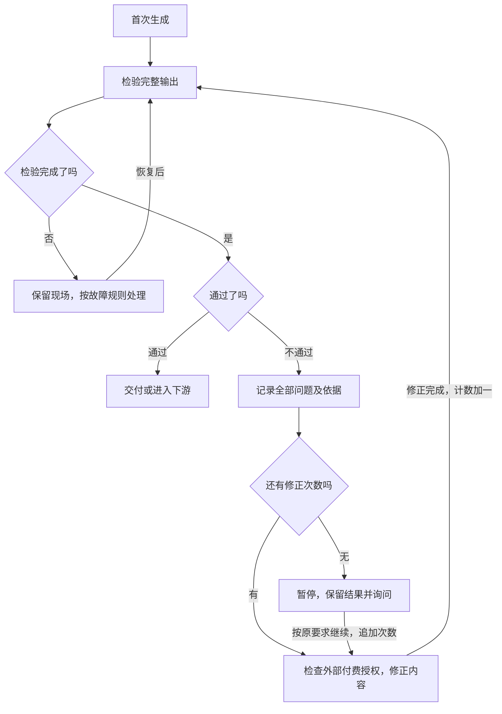

# 人与 AI 协作项目方法论讨论稿

> 存档日期：2026-10-22。设计讨论稿，尚未实现。
> 本文记录截至本轮讨论已确认的设计，不代表现行模板、检查程序或采用框架的项目已支持这些能力。此次只存档，不改现行模板或提示词工作台。后续实施需另行确定方案。

## 1. 基本思路

**把复杂的事情简单化，把简单的事情流程化。**

当前面向人和 AI 一起做项目。用模块组织信息处理，让内容各有归属，让处理过程可以组合、检验、维护和恢复。

模块有三个核心要素：输入信息要求、处理信息的流程、输出信息要求。模块做一件事，不额外单列“职责与边界”。

普通模块按“一次信息处理”划分；生成、查询、下载、检验分别算信息处理，不以函数数量或任务名称划分。程序仅为同一次处理读取材料、组织调用时，不机械拆分；先提取信息再生成内容等多次处理，应拆为模块后组合。

程序、AI 及二者配合都是执行方式，不决定模块划分。程序也需要输入和读取文件，输出也可能因外部服务、时间或随机因素而不同，不能一概要求相同输入产生完全相同输出。

组合模块仍是模块，也有输入、处理和输出，只是处理流程由其他模块组合而成。对外看是一次整体处理，对内可以展开为多次处理。整个项目也是模块，可以再与其他项目组合。

## 2. 文件模板和位置

每个位置的模块各自配备一套文件；共用的是通用模板，不是各位置的定制文件。普通模块、组合模块、整个项目使用同一种基本结构。

文件用英文名，中文对照集中维护在方法首页，各模块 README.md 用中文提供本地导航。以下是已确定名称的示例，不是现行模板目录：

```text
project/
├── module.json                 模块信息
├── README.md                   使用说明与导航
├── INPUT.md                    输入要求
├── OUTPUT.md                   输出要求
├── PROCESS.md                  处理流程
├── VALIDATION.md               业务输出检验标准
├── settings/
│   ├── DEFAULTS.md             默认设置
│   └── PREFERENCES.md          用户偏好
├── knowledge/                  知识资料或共享资料引用，按需配备
├── implementation/             程序代码和 AI 执行指引
├── connections.json            组合的信息连接
├── modules/                    组合的直接成员
│   ├── module-a/               各自采用同一套结构
│   └── module-b/               也可以是组合，继续包含 modules/
├── runs/                       运行记录
└── outputs/                    正式保存的成果
```

普通模块不需要组合专用的成员目录和连接文件。模板另外附 CONFIG_VALIDATION.md（配置检验标准），不与业务输出的 VALIDATION.md 混用；其在模板包中的具体位置待定。

| 文件或目录 | 要写清的内容 |
| --- | --- |
| module.json | 稳定标识、显示名称、采用的模板及版本；显示名称可改，连接通过稳定标识定位 |
| README.md | 用途、输入提供方式、需要读取的文件、启动方式、所需外部工具、文件导航 |
| INPUT.md | 输入内容、格式、必需和可选条件、本次运行上下文 |
| OUTPUT.md | 命名的输出项、格式、保存位置、交付方式、完成条件 |
| PROCESS.md | 步骤、执行方式、人工确认、失败处理与恢复；组合说明成员如何协作并引用连接文件 |
| VALIDATION.md | 判定业务输出合格的标准 |
| settings/ | 默认设置与用户偏好分开保存 |
| knowledge/ | 通用或专用知识、参考资料、示例及共享资料引用 |
| implementation/ | 收到运行指令后实际执行的代码和 AI 指引，由 PROCESS.md 引用 |
| connections.json | 唯一的连接登记，不在说明中维护第二份连接清单 |
| runs/ | 各分身的运行数据、轮次和恢复记录 |
| outputs/ | 用户明确要求留下使用的正式成果 |

模板保留通用知识资料和填写说明；项目材料在配置时添加或引用，不将某项目的知识带入其他项目。不强制每个模块配 tests/ 或检查程序；检验如何执行由检验模块自己的处理流程规定。

新位置接入模块时，从模板重新配置全部位置相关内容，不沿用其他位置的定制、用户偏好、运行记录和成果，并生成新标识。原位置的偏好不自动删除。原地升级不算换位置，保留当前配置，处理新版差异和冲突。

新模块先处于“待配置”。必需配置补齐，文件和连接检查通过后才能运行；可选内容可以留空，不为凑齐内容填写无用信息。

## 3. 配套文件阅读与外部工具

README.md 提供统一导航，PROCESS.md 按步骤注明所需知识资料。每次运行读取输入要求、输出要求、处理流程和生效设置；检验时另读标准，知识资料按需读取，不强制通读知识库。相关版本应可追溯，不能以旧记忆替代实际适用内容。

知识资料有冲突时，按明确的适用条件和版本规则判断；仍无法确定就指出冲突并询问，不自行挑选依据。

README.md 声明所需外部工具，运行入口提供实际连接。工具缺失时暂停相关步骤，其他独立步骤可以继续。账号和密钥不进入模板、知识库或运行记录。

## 4. 输入、指令和连接

输入可以是文字、参数、文件、其他模块数据或其他项目输出；满足输入要求即可使用，不要求补跑前序模块。

**输入满足要求，并收到运行指令，模块才启动。** 指令可以来自智能体对话或前端按钮，不同入口调用同一模块，不各维护一套逻辑。

运行前明确模块、输入和本次设置。已有信息可以沿用，不反复填写；“继续”“处理这个”等指代存在多个可能时先询问。必需输入齐全才处理，可选输入缺少不阻塞。启动流程核对必需项和明确格式，复杂判断按需调用检验模块。

新任务默认使用最新输入，启动时固定版本；明确指定旧版则使用旧版。恢复原任务继续使用原输入。记录须能找回当时输入，可以保存副本或引用固定的历史版本，不必重复复制共享素材。

一次处理允许多项输出，分别命名；连接指定来源输出项和目标输入项，不必整份传递。前一个输出符合后一个输入要求才能直接连接，需要转换、筛选、汇总时加入明确的处理模块，不在交接时隐藏加工。

组合成员以 modules/ 下的直接子模块为准，不再手写一份成员清单；子组合管理自己的内部模块。稳定标识的存储和连接格式须在实施时细化。

组合输入、成员交接、组合最终输出都由 connections.json 表达。通过与不通过的路径也要明确，允许检验反馈回路，但必须有停止条件。组合不得包含自身；信息反馈循环与组合包含不是一回事。

组合按运行指令和处理流程调用相应成员，不默认全跑。允许反复调用，须说明使用的输入、重复和停止条件。要直接使用子组合内部能力时，在当前位置另接同类模块，不跨层连接原组合的内部模块。

同一份数据通过统一写入入口保存。其他模块提交处理结果，由入口协调同时修改，避免多个模块直接写同一份内容。

## 5. 模块设置与用户偏好

设置按以下关系生效：本次明确要求优先于适用用户偏好；没有用户偏好时，组合明确传入的设置优先于内部模块默认设置。组合只传递显式指定的值，不把全部设置自动套给成员。

组合与内部模块的用户偏好冲突时先询问，不自动覆盖。用户偏好只针对特定位置，不随模块迁移到新位置。

修改意见、纠错、功能要求和验收反馈默认只用于当前任务，不能直接登记为偏好，包括候选偏好。记录或修改前说明内容与适用范围并征得同意；反复纠错不能仅凭次数认定为偏好。本次修改也不自动改写默认设置。

设置修改只影响之后启动的分身，已有分身沿用启动时设置。记录当时最终生效值，而非只记后来可能变化的设置文件路径。

已确认的默认设置包括：

| 设置 | 初始值与作用 |
| --- | --- |
| 运行记录保存 | 永久保存；项目提供默认，模块可覆盖 |
| 最多修正次数 | 5 次，首次生成不计入；用完后询问 |
| 允许外部工具付费调用 | 不允许；需要时询问，允许后在任务与次数范围内不重复询问 |

外部付费开关不限制智能体自身的生成、检验和修正；这些仍受任务范围和修正次数约束。修正 5 次是上限，不自动构成外部付费授权。本次明确指令和用户偏好按上述顺序覆盖默认值。

影响内容的设置变化，使受影响旧产物标记“待更新”；保存天数等变化不使业务内容过时。

## 6. 分身、并发与批量

模块保存配套文件和设置，每次运行创建分身，包括只有一个任务时。分身共用文件和设置，分别保存输入、进度、输出、错误。组合每个分身的内部运行记录也独立。

任务携带标识，交接同时匹配标识和输入版本，防止混用不同任务的结果。原输入变化后才到达的结果可保留，注明旧版来源，不能充当新版输入的结果继续传递。

分身结束后自动消失，历史记录仍由所属模块按设置统一管理；运行中、等待恢复或状态待确认时不丢失跟踪信息。不能按一次性分身各保留一次而无限累积历史。

框架不主动设统一并发上限，实际仍受资源和服务限制。互不影响的任务允许并发；争用同一份不可同时操作的资源时，相关步骤排队，不必锁住整个生成流程。

一条指令可以启动一批任务，为每项创建独立分身。批量报告全部成功、部分成功或全部失败，未确认状态另行说明，不把它当失败直接重试。默认只重试已确认失败项，成功项保留，不重复付费提交。

下游可逐项处理就逐项交接，需要整批就等必需输入齐全。组合结束前安排剩余任务等待完成或尝试取消；无法确认停止则继续跟踪任务编号和状态，不直接丢下。

## 7. 检验与反馈修正

业务模块附 VALIDATION.md。检验模块输入待检输出、对应标准，以及标准所需的原始材料或其他依据；输出通过或不通过，不通过时说明违反哪条标准、具体哪里不符合。每轮检查全部适用标准，一次列出发现的全部问题，可以给修改建议，但不得新增要求。

检验按需连接。不接就直接交付，但不宣称检验合格；允许给检验模块再接检验模块，不强制无限复核。模块建立或修改时验证其可靠性，与每次运行是否接检验是不同问题。

正常检验采用该次任务对应的标准版本，启动复查采用当前标准，记录所用版本。缺少必要材料、文件读取失败或调用超时属于检验未完成，报告错误而不是判为不通过。

对于接入反馈修正的组合：

1. 首次生成，然后检验完整输出。
2. 通过则交付或进入后续模块。
3. 不通过则将原始要求、上一轮结果、历次检验意见作为输入传回原模块。
4. 优先修正不合格项，修正后仍检验完整输出，避免改坏其他部分。
5. 默认最多完成 5 次修正，首次生成不计入；实际完成一轮修正才计数。检验执行失败不扣次数，走独立故障处理流程。
6. 用完仍不通过就暂停并保留结果；用户要求继续，默认追加 5 次，指定次数则按指定值，累计轮次保留。

输入、目标或检验标准明确改变时创建新任务，重新计算额度；按原要求继续则沿用原任务。

整个循环归属同一次任务。生成、检验每次调用各创建分身，结束后消失。各轮结果、意见、标准版本、次数统一关联到任务并按整次任务保存规则管理。



## 8. 失败、等待与完成

| 情况 | 处理 |
| --- | --- |
| 输入不合格或运行条件不足 | 不正式处理，说明缺少什么 |
| 临时故障 | 默认最多重试一次；可能重复付费或重复操作时不自动重试 |
| 缺材料、偏好冲突、需要付费授权等 | 保存进度，进入等待用户状态，回答后继续原任务；不占执行名额，不阻塞无关任务 |
| 成员失败 | 暂停依赖结果的步骤，保留已完成成果 |
| 任务超时 | 状态待确认，保留任务编号，继续查询，不自动重新提交 |
| 用户取消 | 尝试取消并核实；不能确认远端停止时如实说明，保留编号、状态和结果 |
| 检验不通过 | 按已配置反馈回路修正，次数用完暂停；不自动无限生成 |

恢复前核对已有状态和结果，避免重复执行。已接检验且未通过的结果不作为合格输入传入正常下游，但可通过反馈连接交回修正。

执行完成、检验合格、正式保存分别记录。按本次输出和交付要求判断是否完成，提交成功、远端完成、本地下载成功、正式保存不是同一件事。未要求检验的任务不伪造检验状态。

删除或覆盖已有成果前明确影响并取得授权；用户已经明确要求删除或替换时不重复询问。按用户确认的保存设置清理运行记录，不逐条询问。

## 9. 保存、正式成果与清理

固定配套文件和运行内容分开。runs/ 按任务标识保存记录；组合记录关联本次内部成员的记录，保留输入版本、模块版本、当时生效设置、进度、输出、错误及修正轮次。

记录保存由用户选择：

- 永久保存，作为初始默认。
- 指定天数，从该次运行完成或失败时计算。
- 只保留最后一次，以结束时间判断；最新一次失败时同时保留最近一次成功结果，直到新的成功结果替代。

项目设默认，模块可覆盖，各模块按自己的设置处理。运行中、等待恢复及组合恢复仍需的记录先保护，不再需要恢复后按设置清理。其他等待或未确认状态如何统一进入清理条件，实施时须与“不得丢失未结束任务”一致。

运行结果先进入 runs/；明确要求保存，或本次指令已指定正式交付时，保存为 outputs/ 中的成果，不强制再问一次。正式成果默认一直保留，不随运行历史清理。组合引用成员成果时不必重复复制。同名默认另存新版本，明确要求替换才替换。

清理是独立模块，输入保存设置、运行记录、引用关系和任务状态，输出清理结果。处理流程为：列候选，排除受保护记录，核对引用，执行前再次核实，然后报告删除、保留及失败。用户原始资料、正式成果和其他记录仍引用的文件不自动删除，无法确认可删的先保留。

## 10. 更新、恢复与启动复查

模板有版本，旧模块继续可用，也支持升级。新增能力尽量兼容；无法兼容时明确新版本与迁移方法，不强制覆盖。

升级比较旧模板、新模板、当前模块三份内容：补入通用更新，保留当前位置配置与用户偏好，不能可靠合并或与新版要求不兼容时询问。升级前留可恢复版本，通过检查后更新版本记录，失败恢复。

更新前暂停新任务，已有分身优先完成；必须中断就保留进度。更新后统一重启。普通设置调整只影响新分身，不要求正在执行的任务切换设置。

重启后恢复未完成任务，已有外部任务先查询原编号，不重新提交。更新后的恢复先检查兼容性；不能兼容则保留现场并询问，不用新流程悄悄续跑旧任务。

输入、所依赖知识或影响输出的设置更新后，相关旧产物标记待更新，保留、不自动重跑。更新还需核对受影响连接，输出不再匹配输入就调整连接或增加转换模块。

配置检查仍是检验模块，不新增特殊模块类型。其输入是目标配置及模板的 CONFIG_VALIDATION.md，输出通过或不通过及原因。新模块必需配置不通过不得运行；业务输出未接检验模块，不等于可跳过配置检查。

更新后先检验配置与连接，再复查历史产物；配置不通过只暂停受影响模块，不继续检验它的产物，不阻塞无关模块。

每次启动，对已接业务检验模块且有保留成功产物的模块，按结束时间选最近一次成功产物，用当前标准复查。没有产物不检查。复查不通过则保留、标记需重新处理，暂停依赖步骤，不自动启动修正生成。

复查只追加检验记录和更新产物状态，不产生新业务结果，不改变业务记录顺序，不挤掉原成果。旧产物符合当前标准，不证明新版处理流程可靠。

## 11. 待确定与实施范围

以下内容尚未定稿，不在存档时擅自补成实现约定：

- module.json、connections.json、运行指令、状态及设置的具体字段和格式。
- 输入输出机器可读定义的文件名和表达方式；已确定 Markdown 写要求，需要自动检查时附格式定义并引用，不重复维护。
- CONFIG_VALIDATION.md 在模板包中的实际位置，模板种类、标识与版本规则。
- 分身及批量任务的创建、调度、等待、重启恢复、存储和清理的实现方式。
- 反馈回路、修正分身与组合普通成员之间的具体登记方法。
- 修改、移动或删除模块时的历史引用和文件迁移细节，以及项目正式成果引用的长期可用性。
- 无可比对历史版本、标准执行依赖缺失或旧任务不兼容时的具体升级操作。
- 新结构对现行模板、检查和全景生成的迁移方案及验收办法。

本文中的“支持”“允许”“保存”等均是目标设计，不是已完成功能声明。现行使用方式仍以仓库当前模板和说明为准。
